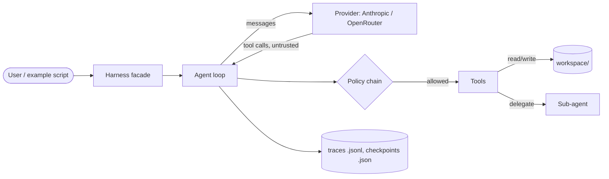

# Threat model

What can go wrong when miniharness runs an agent, and what stops it. Update it when a tool, provider, policy or persistence format is added. Risk IDs refer to the OWASP Top 10 for LLM Applications **2026** (LLMxx) and the OWASP Top 10 for Agentic Applications (ASIxx, December 2025).

## System and trust boundaries

Trust boundaries: **model output** (everything a provider returns, including tool-call arguments) and **tool output** (file contents, sub-agent results) are untrusted. The user's code, `.env` and the `workspace/` path chosen by the user are trusted.

## Assets

| Asset | Where | Why it matters |
|---|---|---|
| Provider API keys | `.env`, environment, `ant` profile | Spend, account abuse |
| Files outside `workspace/` | the user's machine | Integrity, confidentiality |
| Workspace files | `workspace/` | Integrity (undo must work) |
| Budget | `budget=` argument | Unbounded cost |
| Traces and checkpoints | local `.jsonl` / `.json` | Contain prompts, outputs and the working directory |

## Threats and mitigations

| Risk | How it could happen here | Mitigation in the code | Status |
|---|---|---|---|
| LLM01 / ASI01 Prompt injection, goal hijack | A file read by `ReadFile`, or a sub-agent's result, tells the agent to write elsewhere or run something | Tool output is returned as data; every resulting call still goes through the policy chain | partly mitigated: no eval coverage yet |
| LLM03 / ASI02 Excessive agency, tool misuse | The agent gets write tools it doesn't need | `--read-only` hides mutating tools; the policy chain defaults to `DENY`; `ASK` needs an approver | mitigated |
| ASI05 Unexpected code execution / path escape | A tool argument like `../../etc/passwd` or a symlink escapes the workspace | `resolve_in_workspace` resolves symlinks and `..` and rejects absolute paths (tested) | mitigated |
| ASI09 Human-agent trust | The user approves a write without seeing what it does | Approval prompts show the tool call; `rewind()` undoes file changes | partly mitigated |
| ASI03 / ASI08 Privilege inheritance, cascading failures | A sub-agent inherits the parent's write tools or full budget, or loops | Delegated sub-agent is read-only; budget and retry limits apply per call | mitigated; re-check when delegation changes |
| LLM06 Unbounded consumption | A loop or retry storm burns tokens | Budget guard, circuit breaker, dev cache | mitigated |
| LLM02 / LLM08 Sensitive information disclosure | API keys or local paths end up in prompts, traces or checkpoints that get shared or committed | Keys are read from the environment, never put in prompts (the prompt's environment section holds only date, `cwd` and workspace); `.gitignore` excludes `.env`, `*.jsonl`, root `*.json`, `workspace/` | mitigated; the working directory still goes to the provider and into traces |
| LLM10 Improper output handling | Tool-call arguments used without validation | Tools declare JSON-schema parameters | partly mitigated: arguments are not validated against the schema before `run()` |
| ASI04 Agentic supply chain | A compromised dependency or CI action | `uv.lock` with a 7-day cooldown, pip-audit, Dependabot, actions pinned to SHAs, zizmor | mitigated |

## Accepted risks

| Risk | Why accepted | Revisit |
|---|---|---|
| No second human reviewer | Solo project; AI review and required CI checks are the mitigation | If a second maintainer joins |
| Claude Code's `Read` deny rules for `.env*` and key files don't stop shell commands (`cat`, `python -c`) from reading them; this also hides `.env.example` from Read | A `Bash(...)` deny list can't cover every way to read a file, so it would only look like a control. Running Claude Code in its sandbox is the real boundary | If Claude Code's sandbox is enabled for this repo |
| The working directory is sent to the provider and written to traces | Gives the agent useful context; traces are git-ignored | If traces are ever uploaded or shared by default |

## Open items

- Add eval cases for prompt injection through `ReadFile` output and sub-agent results.
- Validate tool-call arguments against each tool's parameter schema before `run()`.
